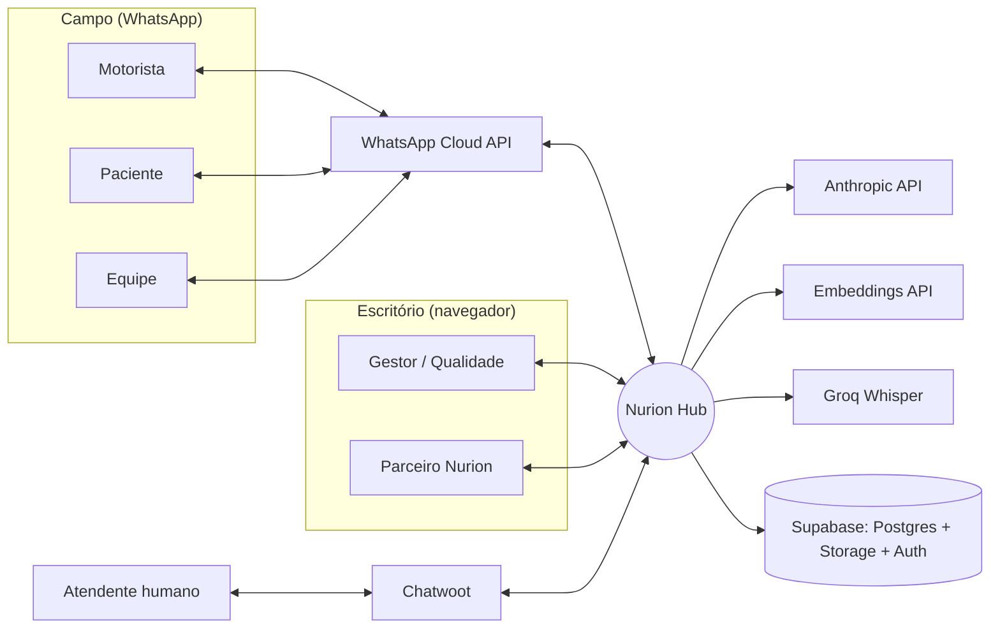
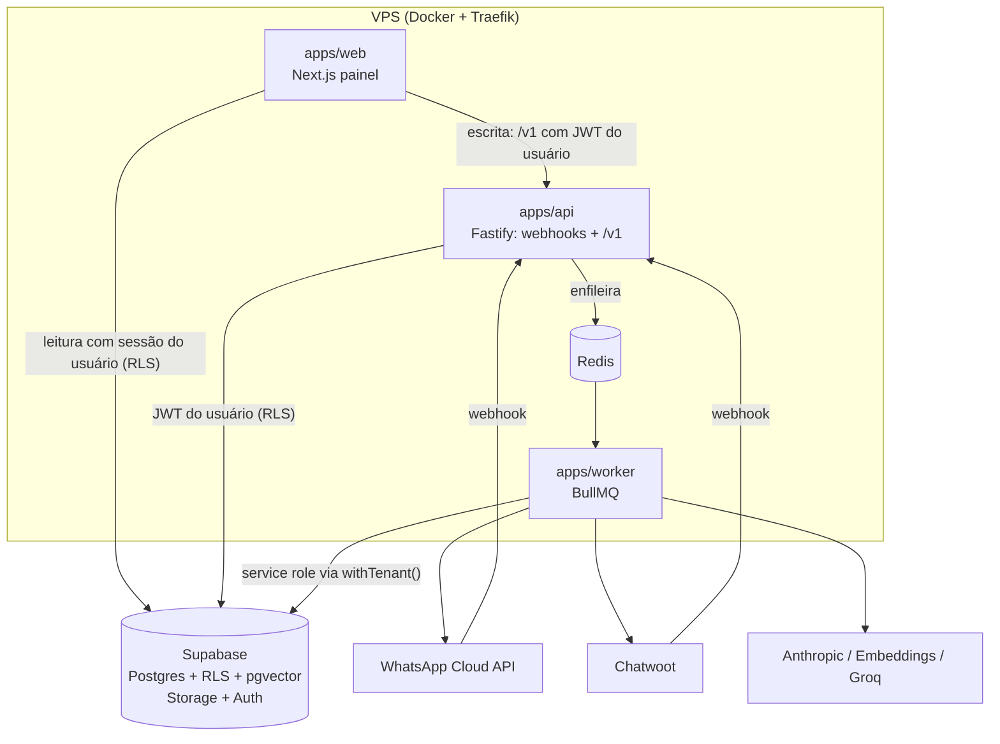
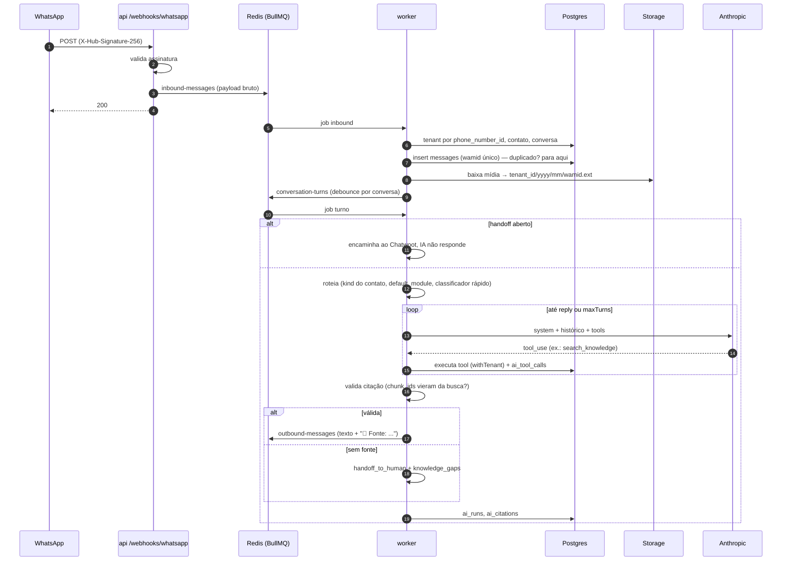
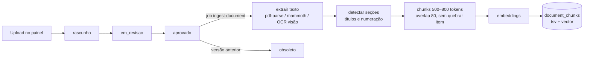
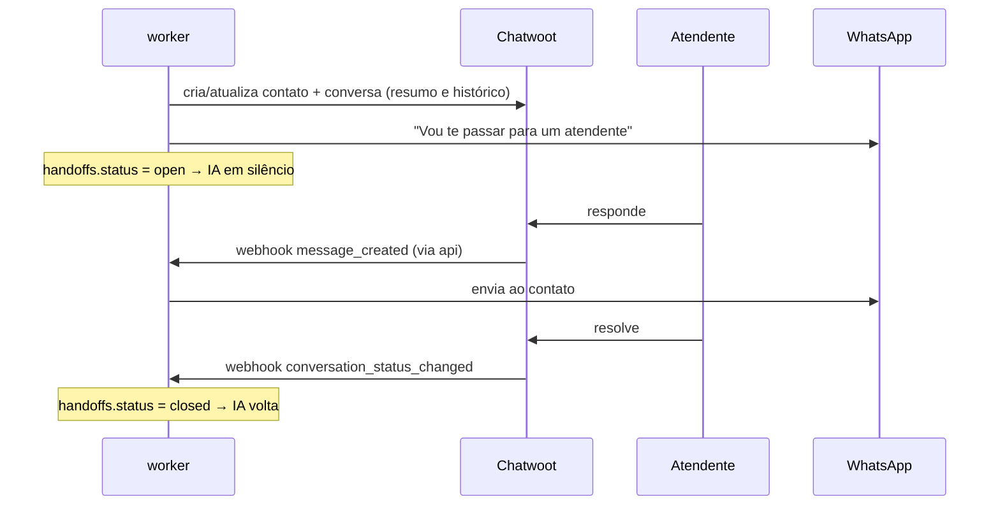

# Arquitetura do Nurion Hub

Para quem chega no projeto e precisa entender como as peças se ligam. Detalhes de tabelas, rotas e
ordem de construção: [`replica/architecture.md`](../replica/architecture.md). Telas e fluxos:
[`replica/recon.md`](../replica/recon.md). Escopo: [`ESCOPO.md`](../ESCOPO.md).

## Em uma frase

Um núcleo multiempresa recebe mensagens de WhatsApp, decide qual agente de IA atende, e esse agente
só responde com base em documentos aprovados do cliente (com fonte) ou registra evidências estruturadas;
o que ele não sabe vai para um humano. Gestores acompanham tudo num painel white-label.

## Contexto

## Contêineres

Três processos, um banco. O webhook nunca processa: valida, enfileira e responde 200 (< 1 s).
Todo trabalho pesado (IA, mídia, ingestão, relatórios) acontece no worker.

## Pacotes

| pacote | responsabilidade | pode importar |
| --- | --- | --- |
| `packages/shared` | schemas zod, tipos de domínio, utilitários, mensagens pt-BR comuns | nada interno |
| `packages/db` | cliente Supabase (sessão do usuário e service role), tipos gerados, `withTenant` | shared |
| `packages/whatsapp` | cliente Cloud API, parser de webhook, assinatura, templates | shared |
| `packages/core` | motor de agentes, tools do núcleo, RAG, multimodal, auditoria, handoff, registro de módulos | db, whatsapp, shared |
| `packages/modules/{log,labs,consult,adm}` | agentes, tools, jobs e rotas de cada módulo | core, shared |
| `apps/*` | composição: montam o registro com os módulos e expõem HTTP/filas | tudo acima |

Um módulo nunca importa outro (lint quebra o build). Se dois módulos precisam da mesma coisa, ela vai
para o núcleo.

## O loop central: mensagem → resposta com fonte

### Roteamento (passo 1.5)

- **Contato:** casado pelo id canônico do WhatsApp (celular brasileiro sempre com o 9). O id que chegou fica em
  `contacts.metadata.wa_id_seen` e é para ele que a resposta vai.
- **Debounce:** cada mensagem agenda o turno da conversa com atraso de 1,5 s e deduplicação por conversa
  (`keepLastIfActive`): várias mensagens seguidas viram um turno só, que lê todas as não processadas.
- **Regras** (`packages/core/src/conversation/router.ts`, função pura): handoff aberto → humano; motorista → Log;
  paciente → Labs; desconhecido → módulo padrão do número, senão Labs (se contratado), senão mensagem de
  identificação + handoff `unidentified`; equipe → módulo padrão do número, módulo da sessão, único módulo,
  classificador rápido (confiança ≥ 0,7) ou pergunta com lista. O módulo escolhido fica na conversa por 2 h.
- **Estado expirado** (§4.10): job a cada 15 min limpa `state` e módulo de conversas com `state_expires_at`
  vencido.

## Motor de agentes

- Um agente é dado (`AgentDefinition`), não uma classe: prompt, tools, escopo de coleções,
  `requireCitation`, `maxTurns`.
- A resposta final sai por uma tool `reply` com `kind` e `chunk_ids`. O código valida os `chunk_ids`
  contra o que `search_knowledge` devolveu na mesma execução e monta a linha de fonte. Sem isso, não
  há resposta: há handoff. Ver [ADR-0006](adr/0006-citacao-validada-no-codigo.md).
- Modelos vêm de `LLM_MODEL_AGENT`, `LLM_MODEL_FAST`, `LLM_MODEL_VISION`. Nunca de uma string no código.
- Toda chamada grava `ai_runs`; toda tool, `ai_tool_calls`; toda fonte, `ai_citations`.

### Como o motor roda um turno (passo 1.6)

1. Contexto: nome da empresa, contato, hora local e as últimas 20 mensagens (só texto; áudio entra como
   transcrição, imagem como aviso).
2. Prompt em dois blocos: guardrails + prompt do agente (com ponto de cache) e, depois dele, a parte que muda
   por conversa. Ferramentas em ordem fixa, para não invalidar o cache.
3. Loop manual (`maxTurns`): cada `tool_use` é validado por zod e executado com `withTenant`; erro de
   ferramenta volta ao modelo como `is_error`.
4. Só `reply` e `handoff_to_human` encerram. `reply` na mesma chamada de outras ferramentas é recusada (não
   pode ter usado resultados que ainda não viu). Texto solto recebe uma cobrança e, na segunda vez, vira handoff.
5. Antes de qualquer envio, grava `ai_runs`/`ai_tool_calls`/`ai_citations`; só depois enfileira a resposta ou
   abre o handoff. Falha de auditoria não deixa resposta sem registro.
6. Recusa do modelo, `max_tokens`, `maxTurns` e erro técnico terminam em handoff com motivo.

O custo vem de `LLM_PRICING` (JSON, USD por milhão de tokens, por id de modelo); modelo sem preço grava custo 0.

## Documentos e RAG

### Ingestão na prática (passo 1.7)

- **Quando:** ao aprovar. Rascunhos e versões em revisão não geram chunks nem custo de embeddings.
- **Extração:** PDF por página (`unpdf`; sem texto = escaneado, falha com aviso até o OCR do 1.9), DOCX (`mammoth`
  → markdown), TXT e MD. O tipo é confirmado pelos bytes, não só pela extensão.
- **Seções:** títulos markdown, numeração (`4.2 Temperatura`) e `ANEXO A`; o caminho (`4 Procedimento > 4.2
  Temperatura`) é o que aparece na citação.
- **Chunks:** por seção, até 800 tokens, 80 de sobreposição, itens numerados inteiros. O texto enviado ao
  embedding leva título e seção junto do conteúdo.
- **Substituição segura:** a versão nova só vira a vigente (e a anterior obsoleta) quando termina de processar,
  numa função SQL transacional. Falha → fica `failed` com o motivo, a anterior continua valendo, e um admin reprocessa.
- **Custo:** embeddings e resumo gravam `ai_runs` (`ingest.embeddings`, `ingest.summary`).

Busca híbrida numa função SQL: vetorial (cosseno) + full-text em português, combinadas por RRF, com
limiar. Abaixo do limiar a busca devolve vazio — e vazio obriga o handoff.
Ver [ADR-0005](adr/0005-busca-hibrida-em-sql.md).

## Handoff (Chatwoot no MVP)

## Isolamento por tenant

Três camadas, todas obrigatórias:

1. **Postgres RLS** em toda tabela de negócio: membro do tenant lê; papel mínimo escreve; tabelas de log
   são só leitura para usuários.
2. **`withTenant(tenantId)`** no worker e nos webhooks: o cliente service role só é acessível por esse
   helper, que injeta o filtro de `tenant_id`.
3. **Storage** com caminho `tenant_id/...` e policies por prefixo; arquivos só por URL assinada curta.

Teste automatizado por tabela: usuário do tenant A não lê, altera nem apaga nada do tenant B.
Ver [ADR-0001](adr/0001-rls-como-guarda-primaria.md).

## Segurança e LGPD

| requisito (§10) | como |
| --- | --- |
| dados sensíveis em trânsito e repouso | TLS no Traefik; Supabase criptografa em repouso; tokens de terceiros com AES-256-GCM na aplicação ([ADR-0004](adr/0004-criptografia-de-tokens.md)) |
| buckets privados | buckets `media`, `documents`, `evidences`, `reports`, `branding` privados (logo pode ser público por tenant) |
| consentimento | `consents` antes de qualquer dado pessoal (Labs); agente checa antes de salvar |
| retenção e anonimização | `tenants.settings.retention_days`; job de retenção; `POST /v1/contacts/:id/anonymize` |
| exportação do tenant | job que gera JSON + arquivos num zip no Storage |
| IA sem treino com dados | APIs comerciais (Anthropic, OpenAI, Groq) via API |
| minimização | o contexto do agente só leva o necessário (sem documento do paciente, por exemplo) |
| logs | nunca logar texto de mensagem nem dados pessoais; só ids |

## Decisões (ADRs)

| # | decisão |
| --- | --- |
| [0001](adr/0001-rls-como-guarda-primaria.md) | RLS como guarda primária; service role só via `withTenant` |
| [0002](adr/0002-leitura-direta-escrita-pela-api.md) | Painel lê direto do Supabase e escreve pela API |
| [0003](adr/0003-auditoria-por-trigger.md) | `audit_log` por trigger no banco |
| [0004](adr/0004-criptografia-de-tokens.md) | Tokens de WhatsApp com AES-256-GCM na aplicação |
| [0005](adr/0005-busca-hibrida-em-sql.md) | Busca híbrida com RRF numa função SQL |
| [0006](adr/0006-citacao-validada-no-codigo.md) | Resposta final por tool `reply` e citação validada no código |
| [0007](adr/0007-embeddings-1536.md) | Embeddings 1536 dimensões, provedor por env |
| [0008](adr/0008-turnos-por-conversa.md) | Um turno por conversa por vez (debounce + lock) |

## Requisitos não funcionais → onde são garantidos

| requisito | onde |
| --- | --- |
| webhook < 1 s | `apps/api` não faz I/O além de Redis; teste de latência no CI |
| IA p95 < 15 s (texto), < 25 s (mídia) | `ai_runs.latency_ms`; painel de custo/latência; `maxTurns` |
| retry exponencial + DLQ | opções padrão das filas em `packages/core/queues` |
| backup diário 30 dias + restauração mensal | Supabase PITR/backups + [runbook](runbooks/backup-e-restauracao.md) |
| custo por tenant | `ai_runs.cost_usd`, `usage_daily`, painel do parceiro |
| evals no CI | `evals/<módulo>` + `pnpm evals`; piora bloqueia o merge |
| RLS testado | `supabase/tests` no CI contra Postgres real |
